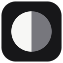

# Darken It

⬅️ **[Download Darken It](https://github.com/Quick-Eyed-Sky/Darkenit/releases/latest)** (open the latest release and download the ZIP file under **Assets**)

A small Chrome extension that dims bright websites. Choose how dark each website should be, and Darken It remembers your choice for that website.

## Features

- Dim a bright page without changing it to black and white.
- Choose the dimming level with a simple slider and preview.
- Save a separate setting for each website domain.
- Turn the effect on or off from the extension popup or the page's right-click menu (**Darken it** in English, **Assombrir la page** in French).
- Apply the saved setting as the next page starts loading, helping avoid a flash of the original bright page.
- Keep your settings in Chrome on your device. Darken It does not send them to a server.

## Install Darken It from GitHub

> This extension is not in the Chrome Web Store yet. Installing it from GitHub uses Chrome's developer mode. This is a normal way to try an extension that has not been published in the store.

### 1. Download the extension ZIP

1. Click **[Download Darken It](https://github.com/Quick-Eyed-Sky/Darkenit/releases/latest)** above.
2. On the release page, find the **Assets** section near the bottom.
3. Click the file named `DarkenIt-vX.Y.Z.zip` to download it. (`X.Y.Z` is the release version, for example `1.0.0`.)
4. Open your Downloads folder and extract the ZIP:
   - **Mac:** double-click the ZIP file. macOS creates a folder beside it.
   - **Windows:** right-click the ZIP file and choose **Extract All…**, then click **Extract**.

Keep the extracted folder somewhere you will not move or delete it. Chrome loads the extension from that folder.

### 2. Load it in Chrome

1. Open Google Chrome.
2. Click the address bar, type `chrome://extensions`, and press **Enter**.
3. Turn on **Developer mode** using the switch in the top-right corner.
4. Click **Load unpacked**.
5. In the folder picker, select the extracted `DarkenIt-vX.Y.Z` folder. Select the folder that contains `manifest.json`—do not select the ZIP file itself.
6. Click **Open** (Mac) or **Select Folder** (Windows). Darken It should now appear on the Extensions page.
7. To keep it visible, click Chrome's puzzle-piece **Extensions** button and click the pin next to **Darken It**.

If Chrome shows a permission message, review it and continue only if you want Darken It to be able to dim websites. The extension needs website access to apply the visual effect on pages you choose.

### 3. Use it on a bright website

1. Open the website you want to dim.
2. Click the **Darken It** toolbar icon.
3. Move the dimming slider to choose how much to dim the page. The interface appears in English or French according to Chrome’s interface language. On Mac, Chrome normally uses the Mac’s default system language.
4. Turn on **Enable on this site** (French: **Activer sur ce site**). Your level is saved for that domain.
5. You can also right-click the page and choose **Darken it** (French: **Assombrir la page**) to turn the saved effect on or off.

The setting is saved by website host, so it also applies to other pages on the same host. It does not change unrelated websites. Darken It follows Chrome’s interface language. On Mac, Chrome uses the Mac’s default system language, so the extension switches between English and French automatically. English is the fallback for other languages.

### Troubleshooting

- **“Load unpacked” is missing:** check that **Developer mode** is on.
- **Chrome says the manifest is missing:** you selected the wrong folder. Choose the extracted folder that directly contains `manifest.json`.
- **The extension stopped working after you moved its folder:** return it to its original location, or load it again from the new location at `chrome://extensions`.
- **You downloaded the GitHub “Source code” ZIP:** extract it and select the project folder containing `manifest.json`. The release ZIP is the simpler download when one is available.
- **You installed an updated release:** extract the new version to a permanent folder, then use `chrome://extensions` → Darken It → **Remove** to remove the old copy, and load the new folder with **Load unpacked**. Removing an extension can clear its saved settings.

## Privacy and permissions

Darken It stores the website domain and your chosen dimming level in Chrome's local extension storage. It does not send page contents, browsing history, or settings to a server. See [PRIVACY.md](PRIVACY.md) for the full plain-English privacy note.

The extension requests access to websites so it can apply the effect to the site you enable. Chrome may describe this as permission to read or change data on websites. Darken It uses that access for the dimming feature; it does not need to read page text.

## For developers

No package manager or build step is required. The extension is made from plain HTML, CSS, JavaScript, and PNG icons.

To try the code in this repository, open `chrome://extensions`, enable **Developer mode**, choose **Load unpacked**, and select this repository folder (the one containing `manifest.json`). After editing a file, click the **Reload** button on the Darken It card in `chrome://extensions`.

See [PUBLISHING.md](PUBLISHING.md) for beginner-friendly instructions to create the GitHub repository, push the code, and publish the first downloadable release.

## Support

Found a problem or have an idea? [Open an issue](https://github.com/Quick-Eyed-Sky/Darkenit/issues).

## License

Darken It is released under the [MIT License](LICENSE).

## About

Darken It is a lightweight Chrome extension for dimming bright websites with a saved setting for each domain.

**Repository:** https://github.com/Quick-Eyed-Sky/Darkenit

## ☕ Support the project

If Darken It is useful to you, you can [buy me a coffee](https://buymeacoffee.com/oFJ5CiY7n). Entirely optional; the extension remains free either way.
